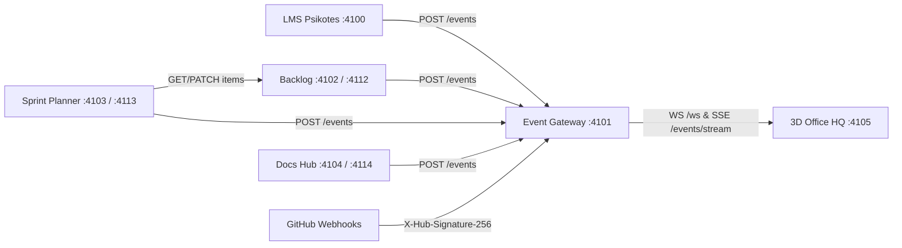

# LokaTalenta Multi-Repo Ecosystem Architecture

LokaTalenta separates its core **LMS Psikotes** platform from its dedicated SDLC tooling (**Backlog**, **Sprint Planner**, **Documentation Hub**) and the multi-floor **3D Office HQ**, interconnected via a central **Real-Time Event Gateway**.

## Topology Diagram

## Design Principles

1. **Bounded Domain Ownership**: Each application owns its SQLite persistence (`node:sqlite`) and REST API while emitting standardized telemetry events.
2. **Fail-Open Telemetry**: Mutations in Backlog, Sprint Planner, Docs, and LMS Psikotes never fail when the Event Gateway is offline.
3. **Hexagonal Contracts**: Canonical 6-division (`executive`, `architecture`, `engineering`, `qa`, `devops`, `lounge`) and 24-agent (`0..23`) identities are shared across all repositories.
